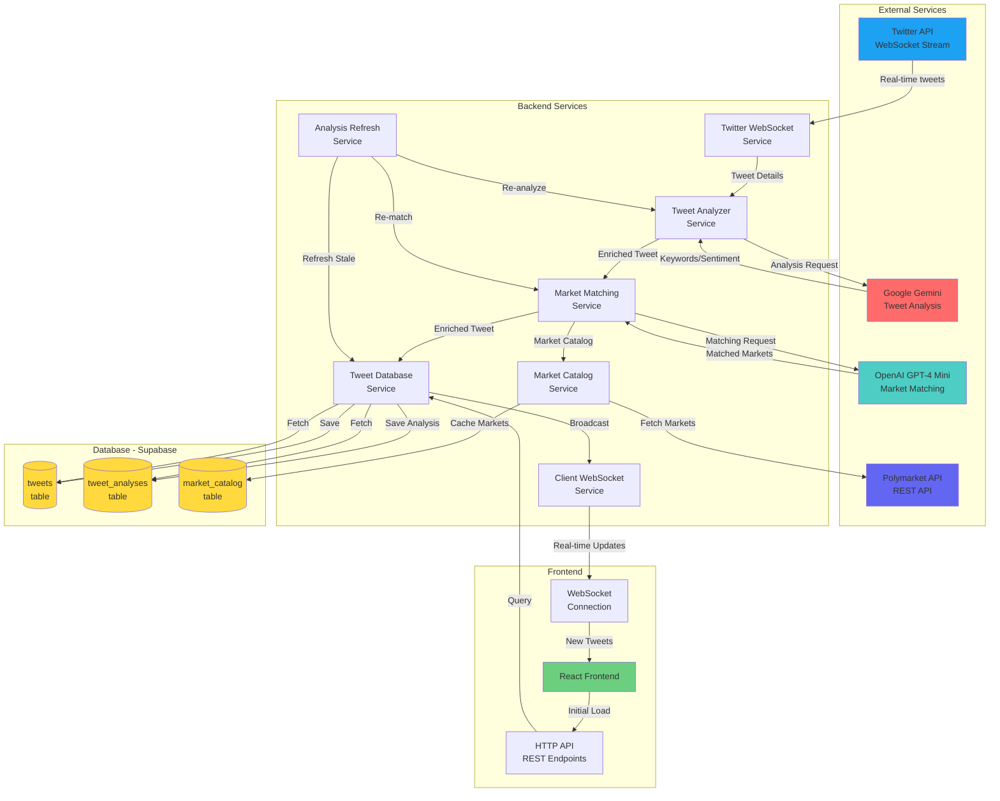
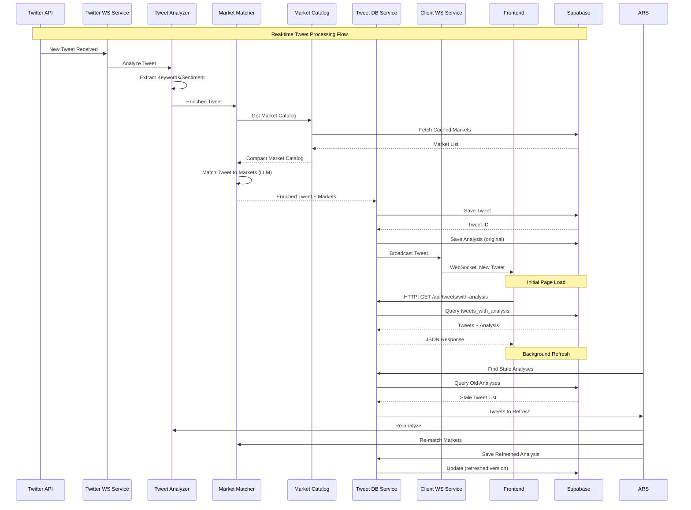
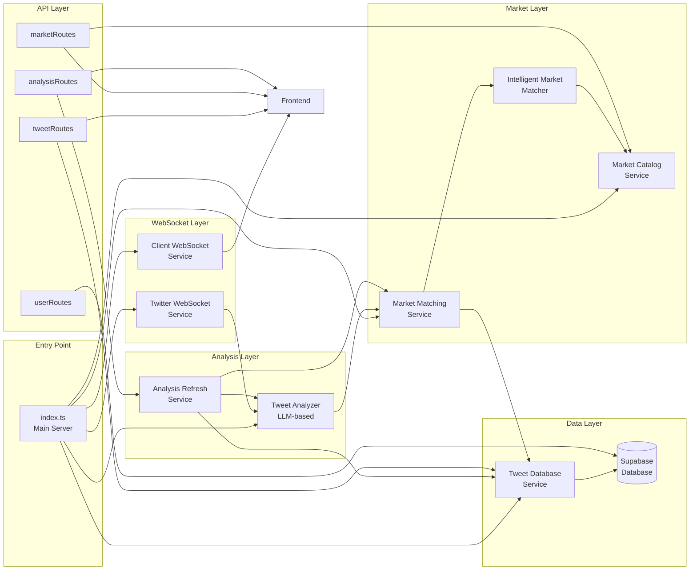
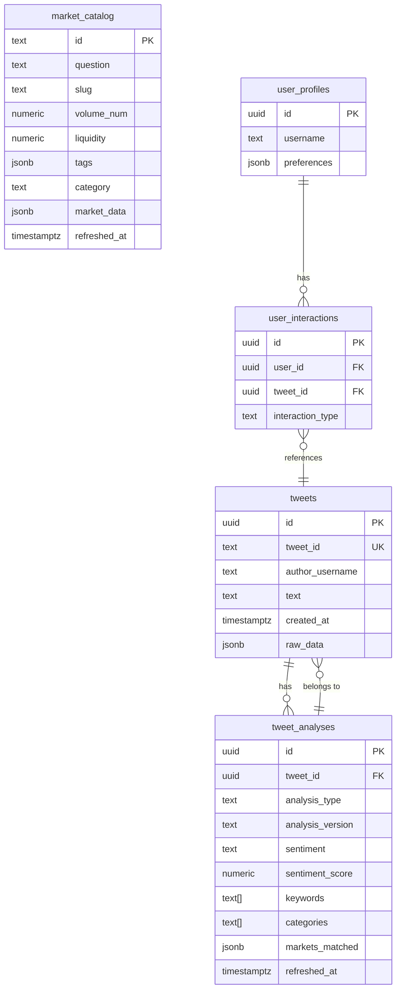
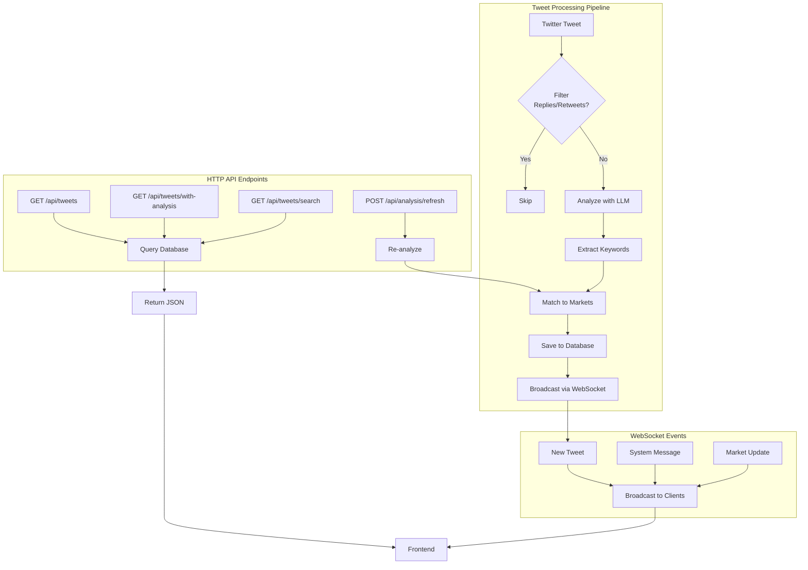
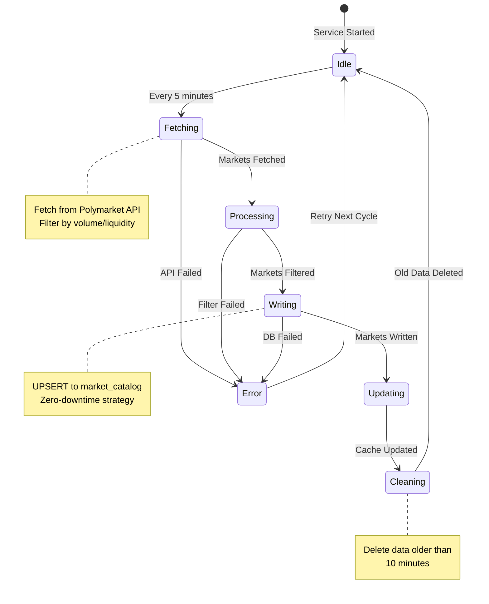
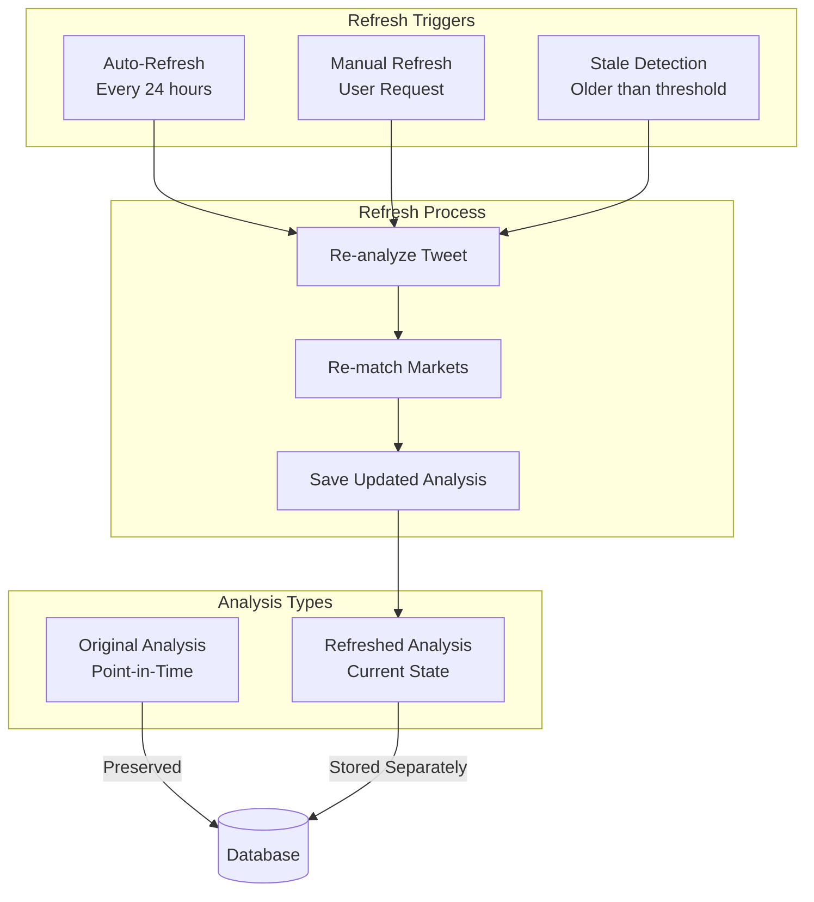
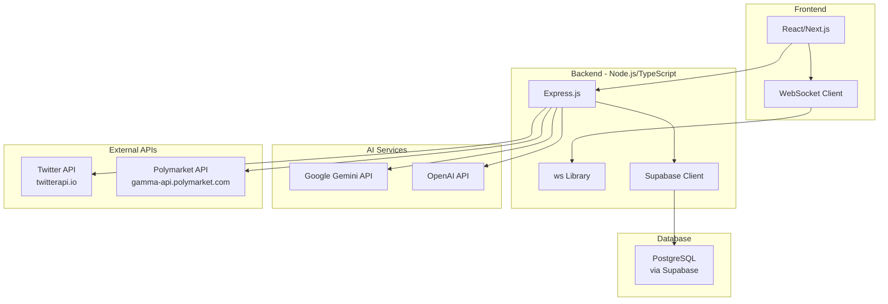

# Poly-Whisper Architecture Diagram

## System Overview

## Detailed Data Flow

## Service Architecture

## Database Schema Relationships

## Request/Response Flow

## Market Catalog Refresh Cycle

## Analysis Refresh Strategy

## Technology Stack

## Key Features

### 1. Real-time Tweet Processing

-  Twitter WebSocket → Analysis → Market Matching → Database → Broadcast

### 2. Intelligent Market Matching

-  LLM-based semantic matching (GPT-4 mini)
-  Cached market catalog (refreshed every 5 minutes)
-  Fallback to keyword search

### 3. Dual Analysis Strategy

-  **Original**: Point-in-time snapshot (fast, historical)
-  **Refreshed**: Current market state (accurate, up-to-date)

### 4. Data Persistence

-  All tweets saved to database
-  Recovery on app restart
-  Historical data access

### 5. Frontend Integration

-  **HTTP**: Initial page load (from database)
-  **WebSocket**: Real-time updates (new tweets)

## Performance Characteristics

-  **Tweet Analysis**: 1-3 seconds (LLM API call)
-  **Market Matching**: 2-5 seconds (LLM + catalog search)
-  **Database Write**: 50-100ms per tweet
-  **WebSocket Broadcast**: <10ms per client
-  **Market Catalog Refresh**: 5-30 seconds (depends on market count)
-  **Analysis Auto-Refresh**: Background, every 24 hours

## Scalability Considerations

-  **Market Catalog**: Cached in-memory + database (fast lookups)
-  **Tweet Storage**: Database with pagination (handles large volumes)
-  **WebSocket**: Broadcasts to all connected clients efficiently
-  **LLM Calls**: Rate-limited and batched where possible
-  **Database**: Indexed for fast queries (created_at, tweet_id, etc.)
